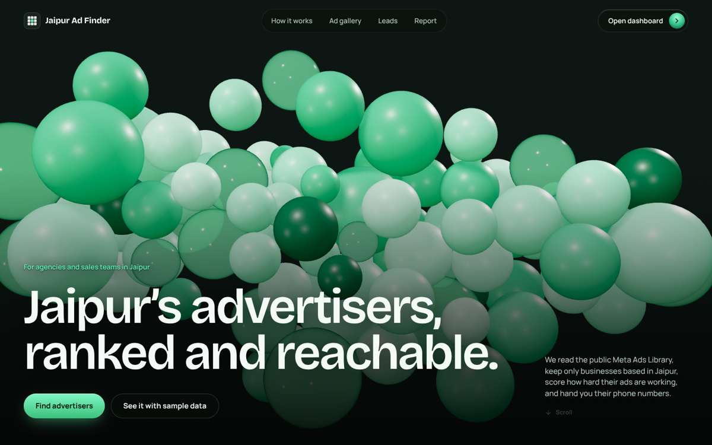
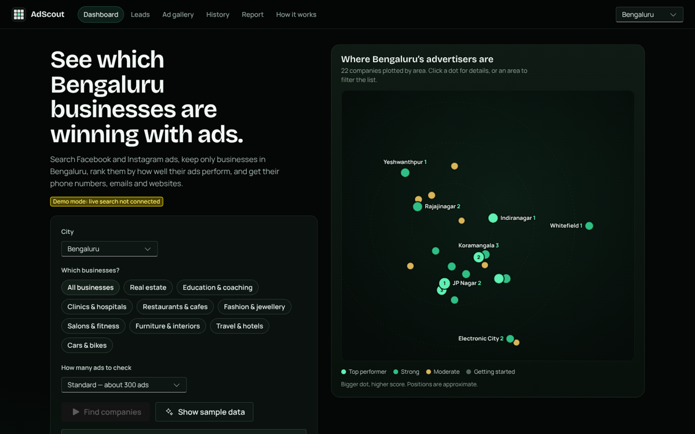

# AdScout

**Find the local businesses that advertise on Facebook and Instagram in your city, see who is doing it best, and reach them.**






## Features

- **7 cities:** Jaipur, Delhi, Mumbai, Bengaluru, Pune, Hyderabad and Ahmedabad, with 180 mapped neighbourhoods
- **Location check:** every advertiser is verified by city name (any spelling or script), PIN code, STD landline code and local area
- **Ad-activity score (0–100)** from public signals: live ads, ad lifespan, platforms, new ads this month
- **Live city map:** advertisers plotted on their neighbourhood, sized by score; click an area to filter
- **Contact details:** phone, WhatsApp, email, website, Instagram and address, with one-click actions
- **Lead tracker:** save companies, track status (To contact → Contacted → Interested → Won), notes, WhatsApp/email message templates, CSV export
- **Ad gallery:** every ad found, filterable by business type and platform
- **History and trends:** each search is saved per city; see who started or stopped advertising and whose score moved
- **Client report:** print-ready PDF with the map, top 10, charts and contacts
- **3D landing page:** real-time Three.js sphere field that follows the scroll, with automatic quality scaling
- **Production-ready:** 27 unit tests, lint and strict types in CI, security headers, optional password lock

## Tech stack

| Layer | Technology |
| --- | --- |
| Framework | Next.js 16 (App Router), React 19, TypeScript |
| UI | Microsoft Fluent UI v9 with a custom black + emerald theme, Bricolage Grotesque and Manrope fonts |
| 3D | Three.js (MeshPhysicalMaterial, custom physics) |
| Data | [Apify Facebook Ads Scraper](https://apify.com/apify/facebook-ads-scraper) reading the public [Meta Ads Library](https://www.facebook.com/ads/library/) |
| Hosting | Vercel |
| Quality | ESLint, TypeScript strict, Node test runner, GitHub Actions |

## Getting started

Requires Node.js 20.9 or newer (22 recommended).

```bash
npm install
cp .env.example .env.local   # Windows: copy .env.example .env.local
npm run dev                  # http://localhost:3000
```

Without `APIFY_TOKEN` the app runs in **Demo mode**: open the dashboard and press **Show sample data** (fictional businesses, any city).

## Environment variables

| Name | Required | Description |
| --- | --- | --- |
| `APIFY_TOKEN` | For live data | Apify API token ([get one](https://console.apify.com/settings/integrations)) |
| `APIFY_ACTOR_ID` | No | Scraper to use. Default `apify~facebook-ads-scraper` |
| `LIVE_SEARCH_PASSWORD` | Recommended | Password for live searches (they spend your Apify credit). Sample data stays open to everyone |
| `SITE_PASSWORD` | No | Locks the whole site behind a password |
| `NEXT_PUBLIC_SITE_URL` | No | Public URL for link previews (Vercel sets one automatically) |

## Scripts

| Command | What it does |
| --- | --- |
| `npm run dev` | Development server |
| `npm run build` / `npm start` | Production build / run it |
| `npm run check` | Lint, type check, tests and build: run before every push |

## Deploy to Vercel

1. Push this repository to GitHub.
2. On [vercel.com/new](https://vercel.com/new), import it (defaults are fine).
3. Add `APIFY_TOKEN` and `SITE_PASSWORD` under **Settings → Environment Variables**.
4. Deploy. Every push to `main` redeploys automatically.

## Adding a city

Add an entry to `lib/cities.ts`: name and aliases, PIN prefixes, STD code, map bounds and approximate area coordinates. Everything else (search terms, location check, map, sample data) picks it up.

## Project structure

```
app/(site)/            Landing page with the 3D field
app/(app)/             Dashboard, leads, ads, history, report, how it works
app/api/               config · scan/start · scan/status · scan/results · enrich
components/            UI (CityMap, LeadsView, AdGallery, HistoryView, ReportView, landing/…)
lib/                   cities · geo · scoring · contacts · normalize · aggregate · apify · leads · history · demo
tests/                 Unit tests (node:test)
```

## Notes

Leads and history are saved in each visitor's browser. Data comes from the public Meta Ads Library. Meta does not publish spend for ordinary business ads in India, so the score measures ad activity, not spend. Use contact details in line with India's DPDP Act.
