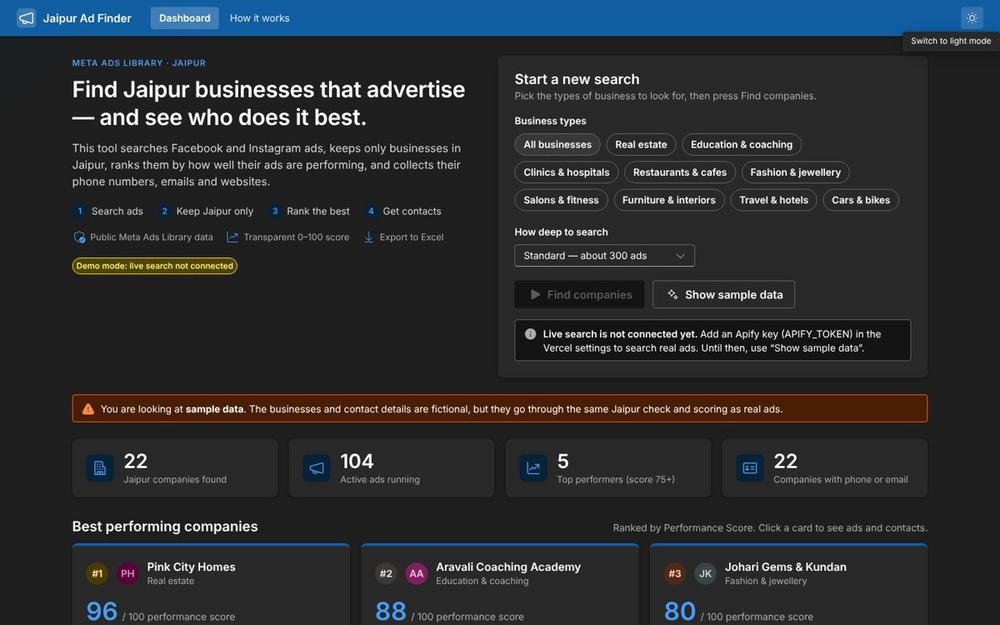
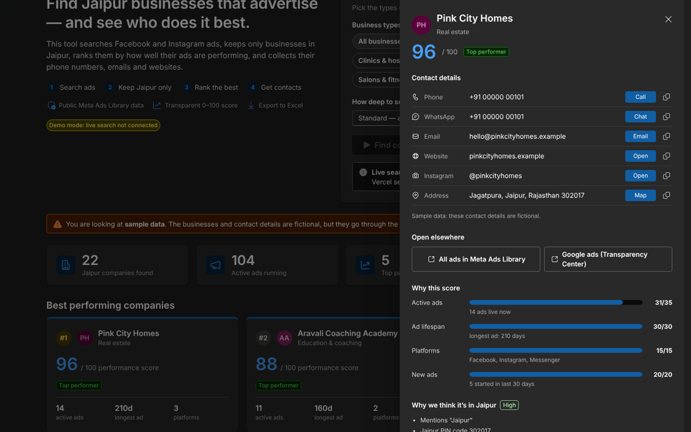

# Jaipur Ad Finder

**Find Jaipur businesses that advertise on Facebook & Instagram, see who does it best, and get their contact details — in one click.**


## Features

- **Search the Meta Ads Library** for Jaipur advertisers by business type (real estate, coaching, clinics, cafés, jewellery…)
- **Jaipur-only filter** — every advertiser is verified by city name, local areas, 302xxx PIN codes and the 0141 phone code
- **Performance Score (0–100)** from public ad signals: live ads, ad lifespan, platforms and new ads
- **Contact details** — phone, WhatsApp, email, website, Instagram and address, with one-click Call / Chat / Email buttons
- **Leaderboard** with search, filters, sorting and **Excel (CSV) export**
- **Microsoft Fluent design**, light & dark mode, fully responsive on mobile
- **Demo mode** with clearly fictional sample data, so it can be presented without an API key
- **Production-ready**: tests, lint, type checks, CI on every push, security headers, optional password lock

| Dark mode | Company details |
| --- | --- |
|  |  |

## Tech stack

| Layer | Technology |
| --- | --- |
| Framework | [Next.js 16](https://nextjs.org) (App Router) · React 19 · TypeScript |
| UI | [Microsoft Fluent UI v9](https://react.fluentui.dev) + Fluent icons |
| Data | [Apify Facebook Ads Scraper](https://apify.com/apify/facebook-ads-scraper) reading the public [Meta Ads Library](https://www.facebook.com/ads/library/) |
| Hosting | [Vercel](https://vercel.com) |
| Quality | ESLint · TypeScript strict · Node test runner · GitHub Actions |

## Getting started

**Requirements:** Node.js 20.9 or newer (22 recommended).

```bash
git clone https://github.com/OWNER/REPO.git
cd REPO
npm install
cp .env.example .env.local   # Windows: copy .env.example .env.local
npm run dev                  # http://localhost:3000
```

Without `APIFY_TOKEN` the app runs in **Demo mode** — press **Show sample data**.

## Environment variables

| Name | Required | Description |
| --- | --- | --- |
| `APIFY_TOKEN` | For live data | Apify API token ([get one](https://console.apify.com/settings/integrations)) |
| `APIFY_ACTOR_ID` | No | Scraper to use. Default `apify~facebook-ads-scraper` |
| `SITE_PASSWORD` | No | Locks the whole site behind a password (any username). Recommended once deployed, so strangers can't use your Apify credits |
| `NEXT_PUBLIC_SITE_URL` | No | Public URL for link previews (Vercel sets one automatically) |

Never commit `.env.local` — it is already in `.gitignore`.

## Scripts

| Command | What it does |
| --- | --- |
| `npm run dev` | Start the development server |
| `npm run build` / `npm start` | Production build / run it |
| `npm run lint` | ESLint (Next.js + TypeScript rules) |
| `npm run typecheck` | TypeScript strict check |
| `npm test` | Unit tests for Jaipur detection, contacts, scoring and the data pipeline |
| `npm run check` | All of the above — run before every push |

## Deploy to Vercel

1. Push this repository to GitHub.
2. On [vercel.com/new](https://vercel.com/new), import the repository (defaults are fine).
3. Add `APIFY_TOKEN` (and ideally `SITE_PASSWORD`) under **Settings → Environment Variables**.
4. Deploy. Every push to `main` redeploys automatically; pull requests get preview links.

## How it works

```
Find companies ─▶ /api/scan/start ─▶ Apify scrapes Meta Ads Library (1–4 min)
                  /api/scan/status ◀─ page checks every 5 s
                  /api/scan/results ─▶ clean ▸ group by advertiser ▸ Jaipur check ▸ score ▸ rank
                  /api/enrich ─▶ visit company websites for phone / email / WhatsApp
```

**Performance Score** = Active ads (35) + Ad lifespan (30) + Platforms (15) + New ads in 30 days (20).
Meta doesn't publish spend for ordinary business ads in India, so the score is an estimate from public signals.
Full details are on the in-app **How it works** page.

## Project structure

```
app/
  page.tsx                Dashboard
  how-it-works/           Plain-language method page
  api/                    config · scan/start · scan/status · scan/results · enrich
  providers.tsx           Fluent UI + light/dark theme
  opengraph-image.tsx     Link-preview image
  error.tsx, not-found.tsx
components/               ScanPanel, Results, CompanyDrawer, AppHeader, AppFooter, useScan
lib/                      jaipur · scoring · contacts · normalize · aggregate · apify · categories · demo · csv
tests/                    Unit tests (node:test)
proxy.ts                  Optional password lock
.github/workflows/ci.yml  Lint, typecheck, test and build on every push
```

## Responsible use

All ad data is public, from the Meta Ads Library. Review Meta's terms before commercial use, keep scraping volumes reasonable, and handle contact details in line with India's Digital Personal Data Protection (DPDP) Act.
